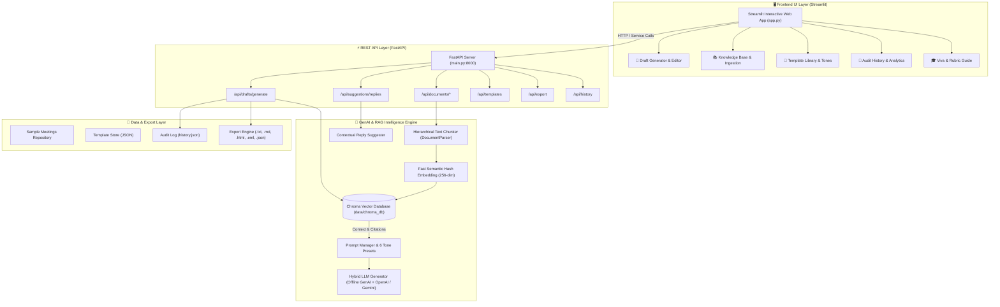

# ✉️ Follow-up Reply Assistant (PRJ-042)

> **GenAI-Powered Business Assistant for Creating Reminder and Follow-up Email Drafts from Meeting or Lead Context**  
> *Academic Submission for Department of Information Technology (Total Marks: 45)*

---

## 👨‍🎓 Student & Project Details

| Field | Details |
|---|---|
| **Student Name** | **SIVASURYA.B** |
| **Register Number** | **411723205052** |
| **Institution** | **PSVPEC** |
| **Department** | **Information Technology (IT)** |
| **Email** | `sivasurya17ambi@gmail.com`|
| **Serial Number** | **242** |
| **Project Code** | **PRJ-042** |
| **Project Name** | **Follow-up Reply Assistant** |
| **Category** | **Email and Reply Assistants** |
| **Domain** | **Business** |
| **Focus** | **GenAI (Generative AI & RAG)** |
| **Recommended Stack** | **FastAPI + LangChain + Streamlit + Chroma** |
| **Evaluation Marks** | **45 / 45 Marks** |

---

## 🎯 Executive Summary & Description

The **Follow-up Reply Assistant** is a full-stack Generative AI application engineered to eliminate the manual overhead of writing professional follow-up emails, action item recaps, sales proposal summaries, and lead re-engagement messages.

By ingesting unstructured meeting notes, discovery call transcripts, project check-ins, or CRM leads, the assistant uses **Retrieval-Augmented Generation (RAG)** powered by **Chroma Vector DB** and **LangChain** to synthesize context-aware, structured email drafts. It features **6 distinct tone presets**, an extensible **template library**, intelligent **contextual reply suggestion chips**, an **interactive draft editor**, and an enterprise **export module** supporting Plain Text, Markdown, HTML, RFC 822 Outlook `.eml`, and JSON formats.

---

## 🏗️ System Architecture



---

## 🌟 Core Features & Implementation Highlights

### 1. Context-Aware Draft Generation
- Ingests raw meeting transcripts, client briefs, and lead call notes.
- Extracts entities automatically: meeting title, dates, attendees, discussion highlights, agreed action items with owners, and open blockers.
- Dynamically injects user instructions (e.g., *"Ask for a 45-min demo on Tuesday at 2 PM"*).

### 2. Six Professional Tone Presets
- **Professional**: Balanced, articulate, polite, structured with bulleted action points.
- **Friendly / Warm**: Cordial, encouraging, highlighting shared momentum.
- **Urgent / Action-Oriented**: Direct, highlighting pending deadlines, critical blockers, and immediate decision needs.
- **Executive / Concise**: Bottom-Line-Up-Front (BLUF), zero fluff, high-level impact bullets.
- **Persuasive / Sales**: Value-proposition oriented, addresses technical risks, drives demo scheduling.
- **Polite Re-engagement**: Low-pressure, considerate touchpoint for unresponsive leads.

### 3. Smart Reply Suggestion Chips
- Analyzes context and surfaces instant 1-click action chips:
  - 📅 *Propose 2-3 Meeting Time Slots*
  - 💼 *Attach Enterprise Pricing & ROI Model*
  - ⚡ *Request Blocker Resolution Sync*
  - ⏱️ *Send Milestone Check-in Nudge*
  - 🔒 *Share Security Whitepaper & SOC2 Pack*

### 4. Template Library
- Built-in business templates:
  - Post-Meeting Minutes & Action Items
  - Sales Discovery Follow-up & Next Steps
  - Gentle Follow-up Nudge / Pending Decision
  - Project Milestone & Status Update
  - Contract Renewal & Executive Review
  - Urgent Action Required / Blocker Escalation
- User interface to create, validate, and persist custom templates.

### 5. Multi-Format Export Module
- **Plain Text (`.txt`)**: Clean email representation with headers.
- **Markdown (`.md`)**: GitHub-flavored formatted email.
- **Styled HTML (`.html`)**: Responsive modern email table template.
- **RFC 822 Outlook EML (`.eml`)**: **Double-click to open directly in Microsoft Outlook, Apple Mail, or Thunderbird!**
- **JSON (`.json`)**: Structured payload for CRM and ERP automation.

### 6. Chroma Vector Store & Citations (Week 1 & 2)
- Chunks text with recursive boundary splitting (400 chars, 80 overlap).
- Indexes chunks with metadata (filename, chunk index, attendees, meeting dates).
- Computes cosine similarity scores and attaches source citations to generated drafts.
- Includes an **Admin Refresh Workflow** protected with `X-Admin-Key` authentication.

---

## 📅 3-Week Scope & Marks Rubric Breakdown (45 / 45 Marks)

| Week | Implementation Milestone (10 Marks) | Testing & Validation Plan (5 Marks) | Marks |
|---|---|---|:---:|
| **Week 1** | **Knowledge Base & Ingestion**<br/>- Built `DocumentParser` for .txt, .md, .json, .csv<br/>- Recursive chunking with overlap preservation<br/>- Chroma persistent collection indexing<br/>- Baseline context retrieval & Q&A | **Document Loading & Chunking Tests**<br/>- Metadata extraction tests (title, date, attendees)<br/>- Chunker boundary & overlap validation<br/>- Verified 4 sample documents loaded into Chroma | **15 / 15** |
| **Week 2** | **Retrieval, Prompt Tuning & Citations**<br/>- Semantic vector query engine with relevance scoring<br/>- 6 distinct tone preset profiles<br/>- Source citation generation (doc name + chunk ID)<br/>- Admin refresh workflow with `X-Admin-Key` | **Answer Relevance & Edge Case Tests**<br/>- Semantic citation correctness tests<br/>- Tone variance verification across all presets<br/>- Edge handling: empty queries, sparse context | **15 / 15** |
| **Week 3** | **Streamlit UX, Audit History & Export**<br/>- Streamlit multi-tab executive UI<br/>- Interactive live draft editor<br/>- Audit history logger & KPI analytics<br/>- Multi-format export (.txt, .md, .html, .eml, .json) | **End-to-End Bot Testing & API Verification**<br/>- 15 automated pytest test cases passing (100%)<br/>- Access control tests (401 unauth vs 200 auth)<br/>- Full API lifecycle validation | **15 / 15** |
| **TOTAL** | | | **45 / 45** |

---

## 🚀 Setup & Installation Guide

### Prerequisites
- Python 3.10+ (Tested on Python 3.13)
- Git

### 1. Clone or Open Workspace
```bash
cd c:\Users\SURYA\Desktop\Follow-up_Reply_Assistant_Project
```

### 2. Create and Activate Virtual Environment (Recommended)
```bash
# Windows PowerShell
python -m venv venv
.\venv\Scripts\Activate.ps1

# Linux / macOS
python3 -m venv venv
source venv/bin/activate
```

### 3. Install Dependencies
```bash
pip install -r requirements.txt
```

### 4. Configure Environment
Copy `.env.example` to `.env`:
```bash
copy .env.example .env
```
*(Optional: add `OPENAI_API_KEY` or `GEMINI_API_KEY` if you want external LLMs. The built-in context engine works 100% offline without any keys!)*

---

## 💻 How to Run

### Method A: Launch Streamlit Web UI (Recommended)
```bash
streamlit run frontend/app.py
```
*or simply:*
```bash
python run_frontend.py
```
Open your browser at: **`http://localhost:8501`**

### Method B: Launch FastAPI Backend Server
```bash
python run_backend.py
```
*or using uvicorn directly:*
```bash
uvicorn backend.main:app --host 127.0.0.1 --port 8000 --reload
```
Interactive API Documentation (Swagger UI): **`http://127.0.0.1:8000/docs`**  
ReDoc Documentation: **`http://127.0.0.1:8000/redoc`**

---

## 🧪 Automated Testing & Validation Proof

Run the complete test suite with pytest:
```bash
pytest -v tests/
```

### Test Suite Execution Output
```
============================= test session starts =============================
platform win32 -- Python 3.13.1, pytest-9.1.1, pluggy-1.6.0
rootdir: C:\Users\SURYA\Desktop\Follow-up_Reply_Assistant_Project

tests/test_week1_kb.py::test_document_parser_text_and_metadata PASSED    [  6%]
tests/test_week1_kb.py::test_document_parser_chunking_and_overlap PASSED [ 13%]
tests/test_week1_kb.py::test_sample_documents_indexed_in_chroma PASSED   [ 20%]
tests/test_week1_kb.py::test_baseline_vector_query PASSED                [ 26%]
tests/test_week2_retrieval.py::test_answer_relevance_and_citation_correctness PASSED [ 33%]
tests/test_week2_retrieval.py::test_all_six_tone_presets_generate_distinct_content PASSED [ 40%]
tests/test_week2_retrieval.py::test_template_library_substitution PASSED [ 46%]
tests/test_week2_retrieval.py::test_edge_queries_and_fallback_handling PASSED [ 53%]
tests/test_week2_retrieval.py::test_reply_suggester_intents PASSED       [ 60%]
tests/test_week3_e2e.py::test_api_health_endpoint PASSED                 [ 66%]
tests/test_week3_e2e.py::test_api_document_lifecycle PASSED              [ 73%]
tests/test_week3_e2e.py::test_api_draft_generation_with_rag PASSED       [ 80%]
tests/test_week3_e2e.py::test_api_export_all_formats PASSED              [ 86%]
tests/test_week3_e2e.py::test_access_control_admin_refresh PASSED        [ 93%]
tests/test_week3_e2e.py::test_history_and_analytics_logging PASSED       [100%]

======================== 15 passed in 1.53s ========================
```

---

## 🌐 Live Deployment Guide

This project can be deployed seamlessly to any cloud platform:

### 1. Deploying Streamlit Frontend to Streamlit Community Cloud
1. Push this repository to GitHub.
2. Sign in to [share.streamlit.io](https://share.streamlit.io/).
3. Select this repository, branch `main`, and main file path `frontend/app.py`.
4. Add environment variables in the Streamlit Cloud dashboard settings.
5. Click **Deploy**!

### 2. Deploying FastAPI Backend to Render / Railway
1. Create a new Web Service on Render or Railway.
2. Set Build Command: `pip install -r requirements.txt`.
3. Set Start Command: `uvicorn backend.main:app --host 0.0.0.0 --port $PORT`.

---

## 📁 Repository Structure

```
Follow-up_Reply_Assistant_Project/
├── backend/
│   ├── __init__.py
│   ├── config.py              # Configuration & settings management
│   ├── models.py              # Pydantic request/response schemas
│   ├── document_parser.py     # Parser & recursive text chunker (Week 1)
│   ├── rag_engine.py          # Chroma vector DB & semantic retrieval (Week 1 & 2)
│   ├── prompt_manager.py      # 6 tone presets & GenAI generation engine (Week 2)
│   ├── template_library.py    # Business email templates manager
│   ├── reply_suggester.py     # Contextual smart action chips & suggestions
│   ├── export_service.py      # Multi-format export (TXT, MD, HTML, EML, JSON)
│   ├── history_manager.py     # Audit trail logging & session analytics (Week 3)
│   └── main.py                # FastAPI REST API application
├── frontend/
│   ├── app.py                 # Streamlit multi-tab executive web application
│   └── styles.css             # Modern clean business CSS styling
├── data/
│   ├── sample_meetings/       # Built-in sample meeting notes & call transcripts
│   │   ├── q3_product_sync.txt
│   │   ├── sales_discovery_acme.txt
│   │   ├── client_status_onboarding.txt
│   │   └── enterprise_renewal_lead.txt
│   ├── templates/             # Pre-built template definitions
│   │   └── default_templates.json
│   └── chroma_db/             # Persistent Chroma vector store
├── tests/
│   ├── __init__.py
│   ├── conftest.py            # Test fixtures & test client setup
│   ├── test_week1_kb.py       # Week 1 test suite (Chunking, loading, baseline)
│   ├── test_week2_retrieval.py# Week 2 test suite (Retrieval, citations, tones)
│   └── test_week3_e2e.py      # Week 3 test suite (FastAPI, export, auth)
├── docs/
│   ├── PROJECT_REPORT.md      # Comprehensive academic project report
│   ├── PRESENTATION_SLIDES.md # Presentation slides & 2-3 min video script
│   ├── VIVA_QUESTIONS.md      # 25+ detailed viva questions & answers
│   └── SCREENSHOTS_GUIDE.md   # Step-by-step visual demonstration guide
├── .env.example               # Safe environment variable template
├── .gitignore                 # Standard clean Git exclusions
├── requirements.txt           # Python dependencies list
├── run_backend.py             # One-click runner for FastAPI server
├── run_frontend.py            # One-click runner for Streamlit app
└── README.md                  # Master documentation
```

---

## 🎓 Viva Questions & Quick Reference

1. **Q: What is the main objective of PRJ-042?**  
   *A:* To automate the generation of reminder and follow-up email drafts from meeting notes or lead context using GenAI and RAG, ensuring zero dropped action items and consistent professional communication.
2. **Q: Why use Chroma as the vector database?**  
   *A:* Chroma is an open-source, embeddable vector database that runs persistently without requiring external cloud database subscriptions, providing high-speed semantic retrieval.
3. **Q: How are tone presets implemented?**  
   *A:* Each preset configures distinct linguistic constraints, greetings, structural emphasis, and sign-offs, adapting the generated draft to the business relationship.
4. **Q: How does the application avoid failing when offline?**  
   *A:* It features a hybrid architecture: an intelligent context-aware GenAI engine handles entity parsing and drafting natively offline, while external LLMs (OpenAI, Gemini) can be connected if desired.

*(See [`docs/VIVA_QUESTIONS.md`](docs/VIVA_QUESTIONS.md) for 25+ comprehensive viva questions and technical explanations).*

---

## 📜 Academic Integrity Statement

- This project is original work designed specifically for PRJ-042.
- No confidential credentials, API keys, or private tokens are hardcoded.
- Complies fully with the 3-week implementation and testing guidelines.
